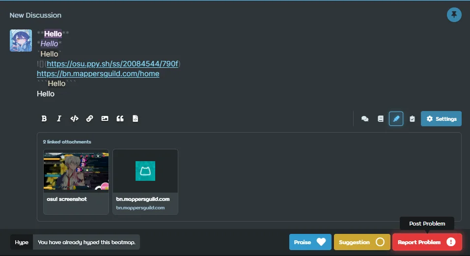
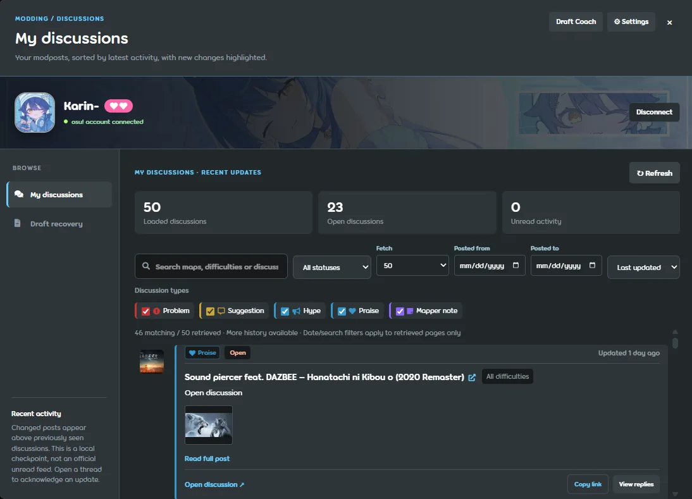
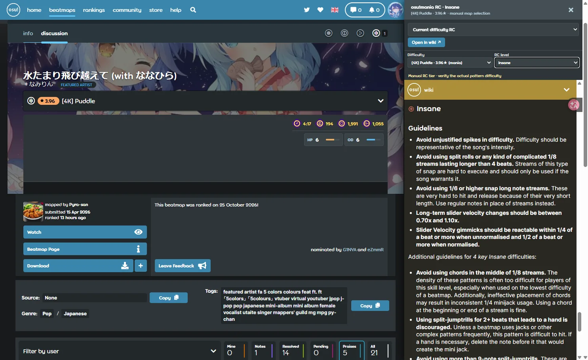
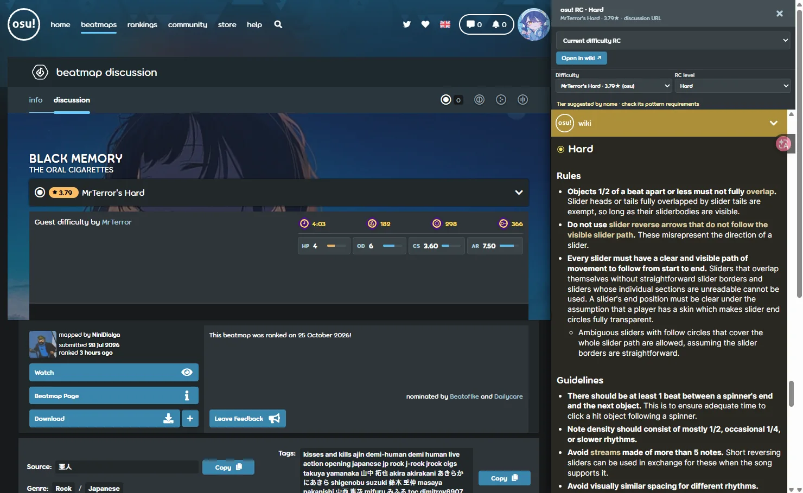
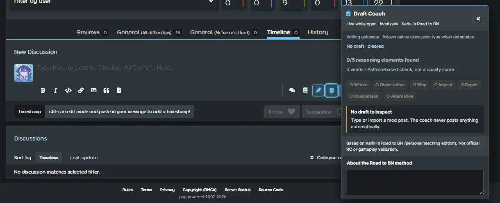
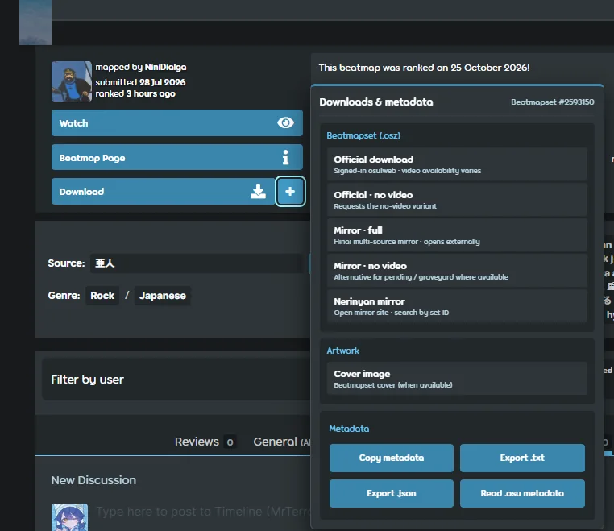
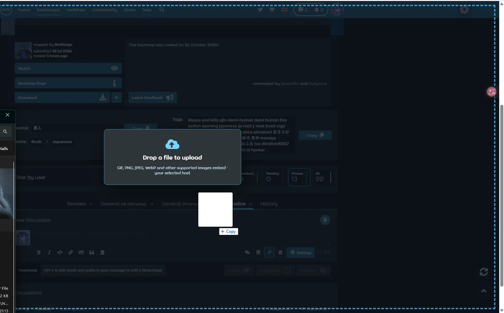
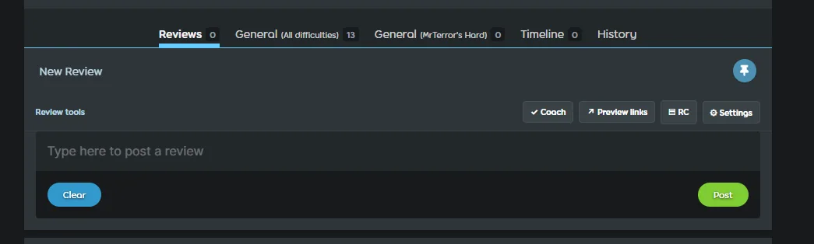

# osu! Modding Helper

An unofficial browser extension for [osu!web](https://osu.ppy.sh/) that improves the **beatmap discussion and modding workflow** without replacing osu!'s post editor. Built around familiar osu!web controls, with tools for mapset inspection, discussion follow-up, writing assistance, Ranking Criteria lookup, and attachments.

**Latest source:** `v1.1.2` (final Markdown and attachment refinements) · **Manifest:** `1.1.2` · **Primary target:** Chromium/Manifest V3. Firefox/Zen runtime support, authenticated flows, and external hosting still require live-browser verification.

> This is a community project, **not** an official osu! or BN/NAT/GMT tool. Nothing here grants moderation privileges or decides whether a beatmap is rankable.

## Showcase

### Discussion editor & personal discussion workspace

| Writing and inline Markdown | My Discussions |
|:--:|:--:|
|  |  |

### Ranking Criteria, writing coach, and metadata

| osu!mania Ranking Criteria | osu!standard Ranking Criteria |
|:--:|:--:|
|  |  |

| Draft Coach | Downloads and metadata |
|:--:|:--:|
|  |  |

| Drag-and-drop image upload | New Review helpers |
|:--:|:--:|
|  |  |

Screenshots illustrate actual development builds supplied for this release. Live osu!web may change its layout or component selectors.

## What changed in v1.1.2

- **Inline Markdown while writing:** the original textarea remains the source of truth; a synchronized styling layer displays bold, italic, strikethrough, code, links, headings, and valid timestamps in place. Markdown markers remain editable. The redundant separate rendered-preview card was removed.
- **Clickable draft links and timestamps:** URLs and `osu://edit/` timestamp references open with one click, while hovering reveals the destination. Alt+click allows caret placement in link text. The overlay can be disabled when font metrics or selection alignment are unreliable.
- **Markdown parsing polish:** plain text receives no synthetic blue background; inline/backtick and true fenced code are distinguished. Same-line triple-backtick sequences no longer color unrelated following lines.
- **Attachment previews:** previewed images, site favicons, and generic file/website cards appear below the editor's toolbar. Five normal cards display before a sixth `+N` overflow tile. Hovering over a card allows removal of the corresponding link from the draft. Chromium can use the favicon API; unsupported sites fall back to conventional icon paths and readable initials.
- **Discussion writing actions:** compact Draft Coach and toolbar toggles, with native-style hover/focus glow on enabled Praise, Suggestion, Problem, and Mapper Note buttons; disabled posting actions remain visibly disabled.
- **Account and discussion management:** session restoration handles asynchronous token refresh more carefully. My Discussions now presents profile and supporter hearts (`support_level` when returned), filters, activity, and API-reported group badges. Comment badges preserve verified multiple usergroups without simulating permissions.
- **Metadata and downloads:** an inspector sits beside osu!web's native metadata-edit control where available, without inventing empty Source rows. The download/metadata popover has distinct, spaced copy/export actions and optional image/audio/mirror features.
- **Ranking Criteria and Reviews:** mode/difficulty reference drawer and compact read-only Review helpers; native Slate Review editing is deliberately not replaced by the discussion textarea overlay.

## Installation

1. Download the installable ZIP attached to the release and extract it.
2. In Chrome/Edge/Brave, open the browser's extension page, enable **Developer mode**, and select **Load unpacked**. Choose the folder containing `manifest.json`.
3. Disable older copies of Modding Helper to prevent duplicate controls.
4. Open a beatmapset discussion on [osu!web](https://osu.ppy.sh/beatmapsets) and reload the page.

For Firefox/Zen, `about:debugging` → **This Firefox** → **Load Temporary Add-on** → select `manifest.json`. Persistent distribution requires Firefox signing and browser-specific compatibility validation.

**You can use the local editor tools without connecting an osu! account.** Account-dependent discussion history and extra usergroup lookups require the extension's separate OAuth connection.

## Main features

| Area | Tools |
|---|---|
| Draft writing | Local Draft Coach, inline Markdown highlighting, clickable URLs/timestamps, discussion helpers |
| Attachments | Image/screenshot thumbnails, favicons, link gallery, paste/drop upload to selected hosts, direct removal |
| My Discussions | Retrieved post history, search/type/date/status filters, activity checkpoint, reply links and local draft recovery |
| Ranking Criteria | In-context RC reference by ruleset and selected difficulty, with official-wiki links |
| Beatmap details | Source/tags/genre/language inspection, available .osu metadata and export helpers |
| Downloads | Official and third-party mirror links where available, no-video options, background and other extraction helpers |
| New Reviews | Contextual Coach, link-preview and RC actions while retaining osu!web's Slate editor |

## Privacy, permissions, and limitations

- **Local Draft Coach is rule-based.** It does not send your mod text to a language model or certify that your feedback is correct.
- osu! API integration uses an **independent third-party token-exchange proxy** at `https://osu-proxy.ameliar-online.workers.dev/`, not osu! infrastructure. Review whether you trust its operator before authorizing it. The configured OAuth scopes do not grant staff powers.
- Embedded image and favicon previews make ordinary browser requests to linked hosts. Uploading sends the files you explicitly select or drop to your chosen hosting provider (s-ul.eu, Catbox, ImgBB or Litterbox); their privacy and expiry policies apply.
- Discussion history/date filters operate on **retrieved pages**, not all server-side posts. Local unread/checkpoint indicators are not official osu! notifications.
- Live React rerenders, CSS, fonts, browser zoom and IME input may affect extension overlays. Disable inline highlighting if text geometry or selection becomes unreliable; the native textarea still owns the draft and submission.
- The current build has passed isolated Chromium fixtures; **live signed-in osu!web, production upload endpoints and Firefox/Zen have not been fully verified**.
- Uploaded screenshots in the gallery are visual examples and do not prove support for every possible beatmapset or editor state.

## Development

The extension uses plain JavaScript and CSS with a Manifest V3 entrypoint; there is no compilation step. `manifest.json` declares the source modules and stylesheets that the browser loads. Do not delete old-looking CSS/JS modules solely based on their filenames: several are still referenced and required.

The most relevant modules are `discussion_stuff/markdown_overlay.js`, `link_preview.js`, `coach_core.js`, `coach_ui.js`, `mod_workspace.js`, `review_tools.js`, and `osu_auth_manager.js`. The README showcase files live under `docs/screenshots/` and are not required at extension runtime.

[osu! Ranking Criteria](https://osu.ppy.sh/wiki/en/Ranking_criteria) · [osu! API](https://osu.ppy.sh/docs/) · [Report an issue](https://github.com/KarinistakenXD/osu-Modding-Helper/issues)

## License

Distributed under the **GNU Affero General Public License v3**. See [LICENCE](LICENCE). osu! trademarks and the game/website itself belong to their respective owners. The included screenshots were provided for the project showcase.
