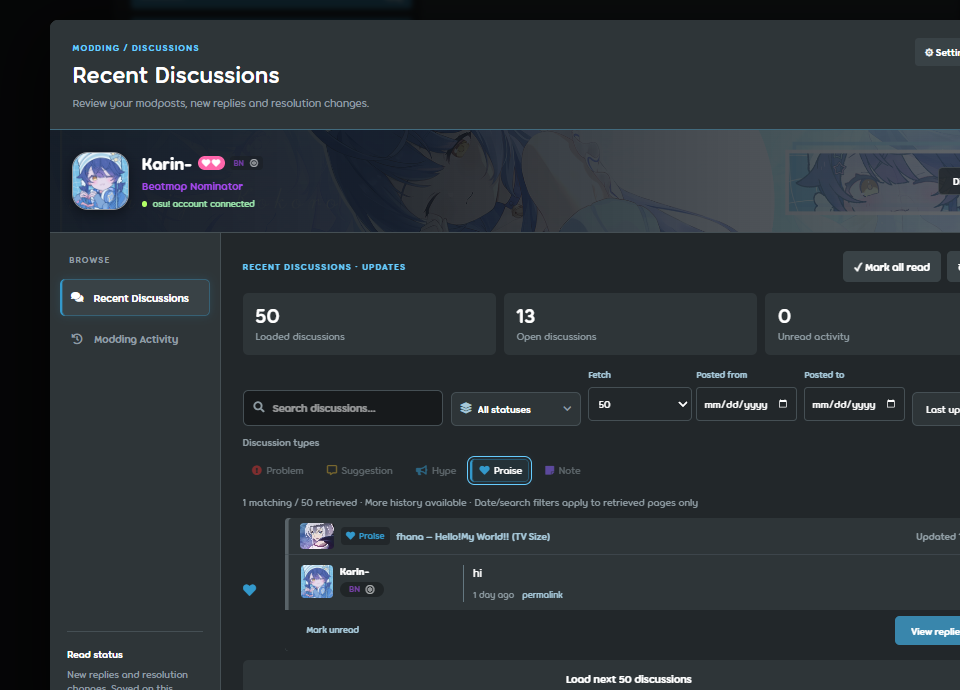
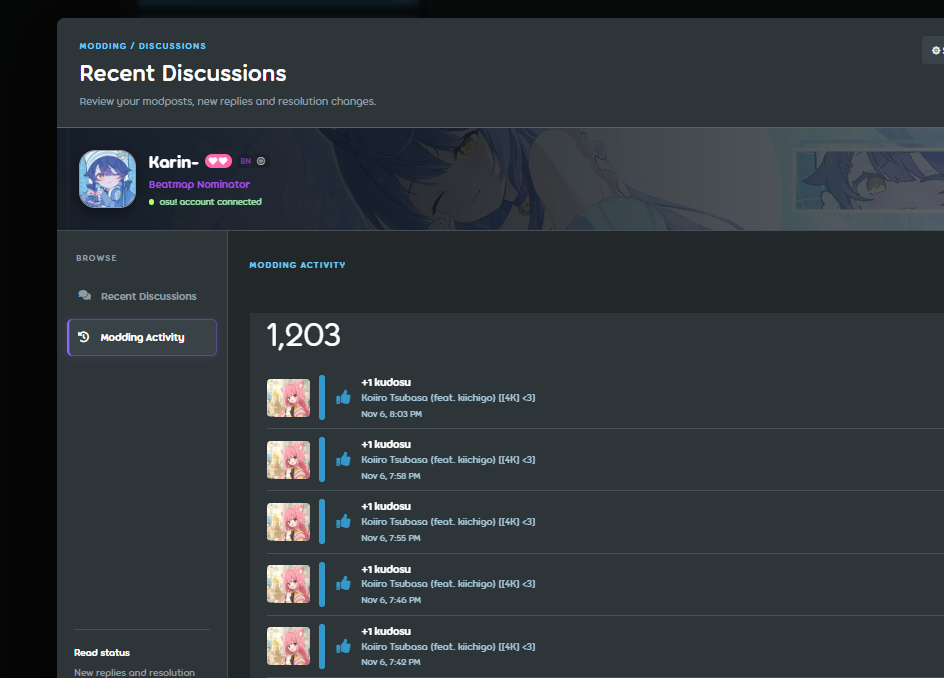
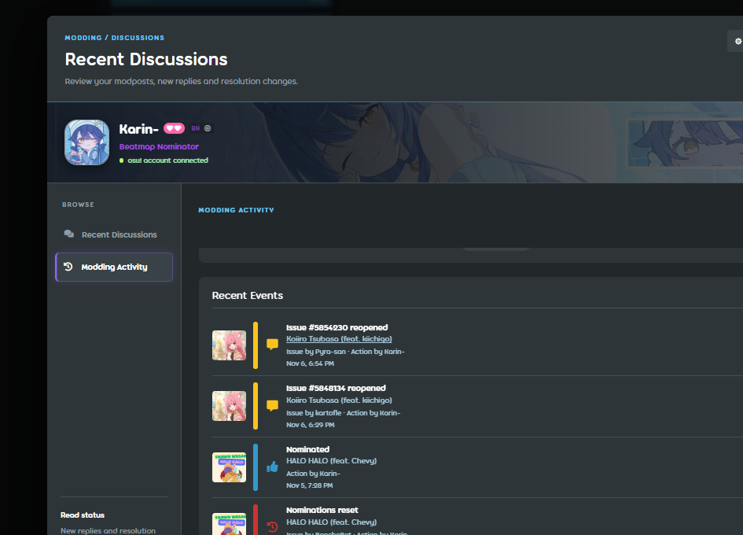
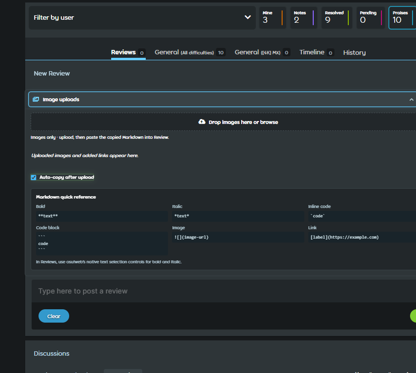
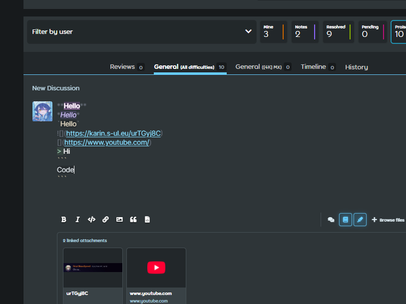
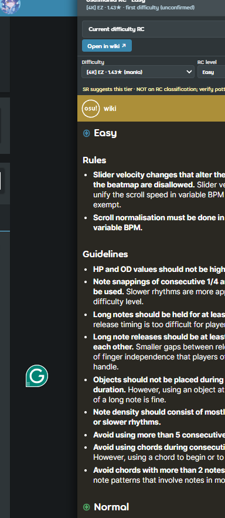
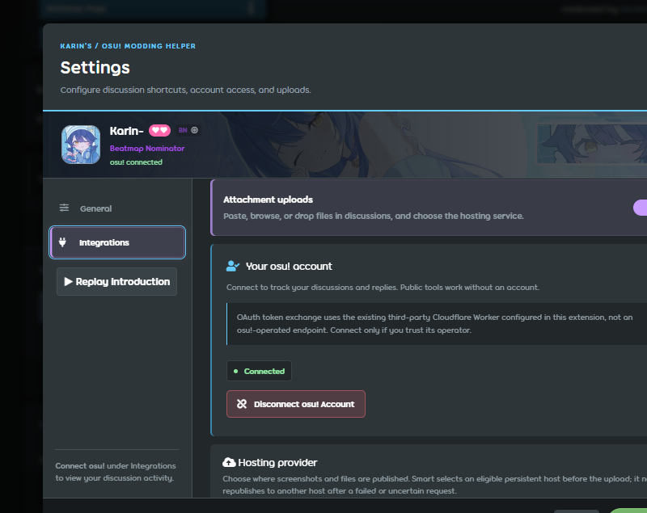
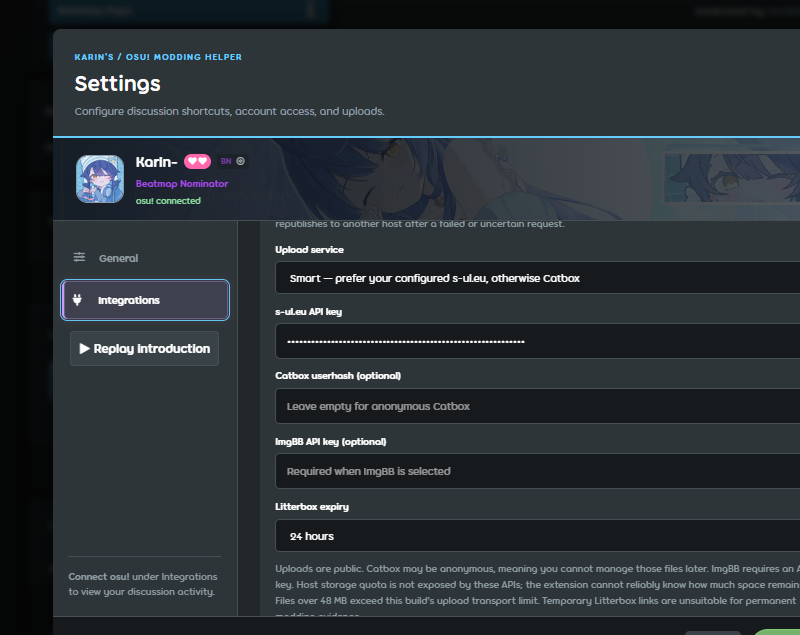

  
  <h1>osu! Modding Helper</h1>
  
More convenient beatmap discussions, modding activity, uploads, metadata, and Ranking Criteria tools—directly on osu!web.

  

    <a href="https://github.com/KarinistakenXD/osu-Modding-Helper/releases">Download</a> ·
    <a href="#screenshots">Screenshots</a> ·
    <a href="#installation">Installation</a> ·
    <a href="https://github.com/KarinistakenXD/osu-Modding-Helper/issues">Report an issue</a>
  

> [!NOTE]
> This is an unofficial browser extension. It is not developed, maintained, or endorsed by the osu! team, Beatmap Nominators, or Nomination Assessment Team.

## Overview

**osu! Modding Helper** adds lightweight tools to osu!web's beatmapset pages without replacing the native discussion and Review editors. You can inspect your modding history, check Ranking Criteria, preview linked attachments, and handle routine metadata and download tasks in fewer steps.

| Area | What it offers |
| --- | --- |
| **Discussions** | Inline Markdown styling, clickable links and timestamps, attachment previews, and image uploads with posting protection. |
| **Recent Discussions** | Search and filter your modposts, expand replies, and track new replies or resolution changes with local read markers. |
| **Modding Activity** | Kudosu history with beatmap covers, public modding events, and nominated beatmapsets for eligible mapping-staff accounts. |
| **Reviews** | A separate image uploader with thumbnails, generated Markdown, and copy/paste support. |
| **Ranking Criteria** | A side panel for looking up relevant RC sections while browsing beatmaps. |
| **Metadata & downloads** | Click-to-copy metadata, export tools, additional download sources, and osu!direct shortcuts. |
| **Settings** | Optional osu! account connection, upload-provider settings, and feature toggles. |

## Screenshots

Screenshots are from the v1.1.3 interface. Certain account-specific features depend on osu! authentication and usergroup membership.

### Recent Discussions

Find previous modposts, filter by discussion type or status, and expand replies. **Mark read** and **Mark unread** are local checkpoints; they do not change osu!web notifications.

### Modding Activity

Kudosu history and public modding events are shown separately. Events include issue resolution/reopening and nomination-related activity when the API returns them. For recognized mapping-staff memberships, this area can also show nominated beatmapsets.

  
<b>Kudosu history</b> — totals, recent entries, and beatmap artwork

  

  
<b>Recent events</b> — resolutions, nominations, and nomination resets

  

### Review image uploads

In **New Review**, expand **Image uploads** to upload files, see previews, and copy image Markdown. The uploader is separate from osu!web's rich-text Review editor; paste the copied text into Review yourself.

### Discussion editor and Ranking Criteria

The normal discussion composer supports inline Markdown styling, link/timestamp interactions, and linked attachment previews. The RC panel stays available alongside the beatmap page.

  
<b>Discussion editor</b> — formatting and attachment cards

  

  
<b>Ranking Criteria panel</b> — difficulty-specific RC reference

  

### Settings and account integration

When connected, Settings shows the osu! profile's public avatar, cover, supporter hearts, and reported usergroups. Under **Integrations**, choose an upload provider and manage the optional osu! account connection.

  
<b>Account connection and Settings</b>

  

  
<b>Upload providers</b> — s-ul.eu, Catbox, ImgBB, and Litterbox

  

## Installation

The extension is currently distributed as a manual-install browser extension.

1. Download an extension ZIP from [Releases](https://github.com/KarinistakenXD/osu-Modding-Helper/releases), then extract it.
2. In Chrome or a Chromium-based browser, open `chrome://extensions`.
3. Enable **Developer mode** and select **Load unpacked**.
4. Select the extracted folder containing `manifest.json`.
5. Open an [osu! beatmapset](https://osu.ppy.sh/beatmapsets) and refresh the page if it was already open.

If you installed an older copy separately, disable it to avoid duplicate extension controls. Chromium-based browsers are the primary target; other browsers may require different installation steps and may behave differently.

## Using the main features

**Discussion uploads.** Use **+ Browse files**, paste an image, or drop a file on the supported upload area. Posting controls are temporarily disabled while an upload is processing. Once the upload completes, the attachment can be previewed and linked in the draft.

**Review uploads.** Expand **Image uploads**, choose or drop an image, then use **Copy Markdown** (or click its copyable source). Paste it into the native Review editor with `Ctrl+V` / `Cmd+V`. Optional auto-copy may overwrite the clipboard after an upload. Review formatting and block insertion remain under osu!web's own controls.

**Metadata.** Click the displayed **Source** value to copy it, **Genre / Language** to copy both, or **Tags** to copy the tag list. Available page metadata remains copyable without connecting an osu! account.

**Downloads.** The beatmapset download controls group **Download**, **osu!direct**, and **+**. osu!direct opens an `osu://` link using an installed osu! client; access may depend on your osu!supporter status and client support.

**Recent Discussions.** Open the workspace to search loaded discussions, inspect replies, filter by type or status, and mark updates as read. Rechecking replies and resolution events may require an osu! account connection. Read markers are stored in this browser only.

## Privacy, authentication, and limitations

- **Account connection is optional.** Public page tools work without OAuth; personal history and account-specific features require a connection.
- **OAuth uses a third-party service.** The extension's configured token exchange runs through a third-party Cloudflare Worker, **not an osu!-operated authentication service**. Review the provider information in **Settings → Integrations** before connecting. Do not enter your osu! password into extension dialogs.
- **Uploads go to external hosts.** s-ul.eu, Catbox, ImgBB, and Litterbox have different credentials, limits, retention policies, and availability. Uploaded files may be public. Litterbox links are temporary; they are not suitable for permanent modding evidence.
- **A successful upload response is not proof of reachability.** A returned link can still fail due to the host/CDN or network. Check the resulting URL before posting it.
- **Recent Discussions read state is local.** It does not modify official osu! notifications or server-side read receipts.
- **Modding history is partial.** Public API results and paginated histories are not a complete BN moderation log; the extension does not provide privileged nomination or moderation actions.
- **Review compatibility is deliberately conservative.** The image uploader does not insert directly into the Slate editor or replace native formatting. Markdown pasted into Review may not be rendered as rich text while editing.

## Troubleshooting

| Problem | Try this |
| --- | --- |
| Extension controls do not appear | Check that the extension is enabled, refresh the beatmapset page, and disable duplicate installations. |
| osu! account appears disconnected | Check **Settings → Integrations** and reconnect; a third-party authentication-service failure may also be involved. |
| Upload does not finish | Check the configured provider, credentials, and file size. Retry only after the pending request has failed or timed out. |
| Upload returns a link that does not load | Open the link directly and check the hosting provider's availability; do not assume a successful API response means the image is accessible. |
| Review formatting behaves unexpectedly | Use osu!web's native Review formatting controls. The extension's Review uploader is for obtaining image links. |

For reproducible issues, open a [GitHub issue](https://github.com/KarinistakenXD/osu-Modding-Helper/issues) with your browser, extension version, reproduction steps, and any relevant console errors. Avoid sharing OAuth tokens or upload API keys.

## License

Licensed under the [GNU Affero General Public License v3.0](LICENCE).
